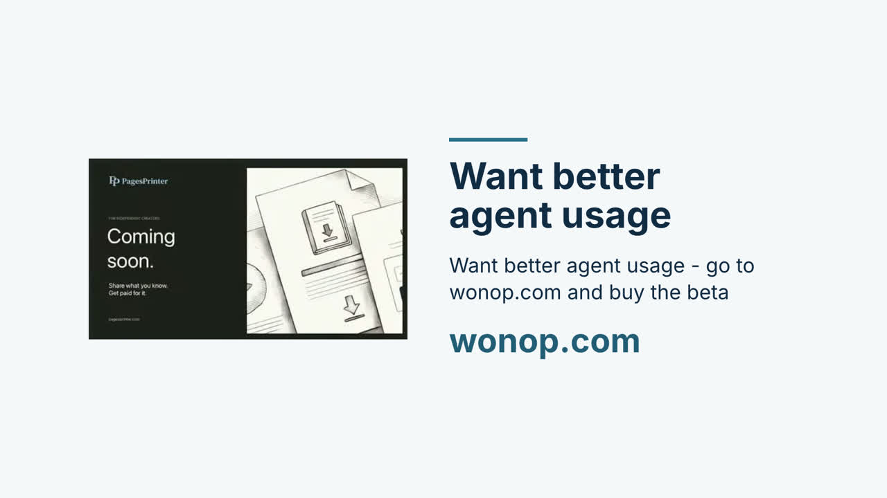

# Agent Social Media Scheduler

Give your agent videos. Let it plan the next few days, wake itself up, and schedule each post through your signed-in Chrome browser.

A portable [Agent Skill](skills/agent-social-media-scheduler/SKILL.md) for **Claude and OpenAI agents** with Chrome extension access and native scheduled actions. No social media API keys required.

## Watch: building a Pages Printer card with Wonop

[](https://github.com/wonop-io/agent-social-media-scheduler/releases/download/v1.0.0/pages-printer-wonop-60s.mp4)

[Play or download the 60-second video](https://github.com/wonop-io/agent-social-media-scheduler/releases/download/v1.0.0/pages-printer-wonop-60s.mp4).

Real footage from [the supplied Wonop livestream](https://youtube.com/live/E-uvVeSDXyE), edited with HyperFrames: request a Pages Printer coming-soon card, use its brand assets, refine the design, and reveal the result. YouTube metadata dates this stream October 28, 2026. Editable composition and cut instructions are in [`video/edit/`](video/edit/).

**[Want better agent usage - go to wonop.com and buy the beta](https://wonop.com)**

## Requirements

- A compatible Claude or OpenAI desktop agent with its Chrome extension enabled.
- Chrome signed into the exact social accounts you want to use.
- Native scheduled actions that can run later with access to the same Chrome profile and video files.
- Your machine awake and online when a local scheduled action runs.

This repository supplies instructions, not an extension or scheduling service. Host support differs. A cloud task or ordinary API/CLI session does not automatically have local Chrome access. If either capability is missing, the skill saves an **unarmed plan** and explains what is needed.

## Install

Clone this repository:

```bash
git clone https://github.com/wonop-io/agent-social-media-scheduler.git
cd agent-social-media-scheduler
```

### OpenAI / Codex

Copy the skill folder into your local skill directory:

```bash
mkdir -p ~/.codex/skills
cp -R skills/agent-social-media-scheduler ~/.codex/skills/
```

In ChatGPT desktop, enable the Chrome extension through **Settings → Computer Use**, then select Chrome in your chat. Use a host that exposes native scheduled actions. See [OpenAI browser setup](https://learn.chatgpt.com/docs/chrome-extension) and [skill installation](https://learn.chatgpt.com/docs/build-skills).

Invoke `$agent-social-media-scheduler` in Codex, or select the installed skill in a supporting ChatGPT host.

### Claude

For Claude Code, copy the same folder into its personal skills directory:

```bash
mkdir -p ~/.claude/skills
cp -R skills/agent-social-media-scheduler ~/.claude/skills/
claude --chrome
```

Invoke `/agent-social-media-scheduler`. Use a Chrome-enabled desktop host with persistent scheduled tasks for multi-day execution. Claude Code session cron tasks depend on the session and have expiry/restart limitations; they are not an independent background service. See [Chrome setup](https://code.claude.com/docs/en/chrome) and [scheduling options](https://code.claude.com/docs/en/scheduled-tasks).

## Use

Give the agent your files or persistent video links, and a brief:

> Use agent-social-media-scheduler. Here are three videos. Plan them over the next three days for my Wonop LinkedIn page and YouTube channel. Use Europe/Copenhagen time. Write a caption for each platform and a first comment linking to wonop.com. Create scheduled wake-ups and use my Chrome extension to schedule the posts.

Or ask it to create the material first:

> Use agent-social-media-scheduler. Make two short videos from this stream about building the Pages Printer card in Wonop. Schedule them over the next few days for my specified LinkedIn and YouTube accounts, using Chrome. My timezone is Europe/Copenhagen.

The agent connects to Chrome, checks the accounts, inspects the videos, chooses dated slots, and stores complete posting briefs in private durable storage. It creates one wake-up per item and reports the confirmed action IDs. Each wake-up carries the video location, exact text, optional first comment, accounts and publish time.

A wake-up normally runs 15 minutes before publication so it can upload and use the platform's scheduler. If the platform cannot schedule natively, a publish-time wake-up handles it. First comments on scheduled posts get their own follow-up after publication.

**A plan is not a scheduled post.** The agent reports whether each item is planned, armed, scheduled on the platform, or published. It verifies submissions and checks for duplicates before retrying. Browser logins and host permission prompts may still need you.

## Change or cancel a campaign

Ask the same agent to inspect its saved campaign and action IDs before changing anything:

> Move the second video to Friday at 14:00 Europe/Copenhagen. Update its wake-up and any post already scheduled on the platform. Confirm both changes.

> Cancel this campaign. Disable its item and comment wake-ups, and remove any still-pending platform posts. Leave published posts alone.

Keep campaign files and media available until every post and first comment is verified. Do not commit account details, private media or campaign manifests to a public repository.

## Video source and reproduction

See [`video/README.md`](video/README.md) for source timestamps, download and rendering commands. The full stream and extracted media are excluded from Git. The finished MP4 is distributed as a GitHub release asset; GitHub READMEs do not reliably play inline HTML video, so the preview image links directly to it.

## License

[MIT](LICENSE) for the skill, documentation and authored composition. Source livestream footage and any third-party assets retain their original rights.

## Get Wonop

**[Want better agent usage - go to wonop.com and buy the beta](https://wonop.com)**
